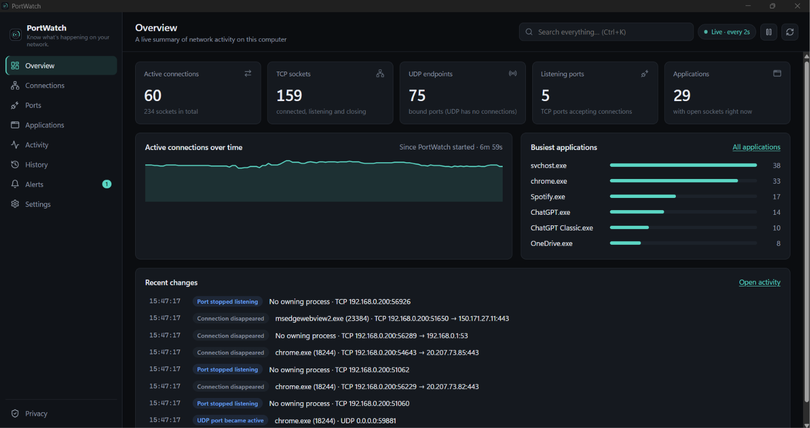
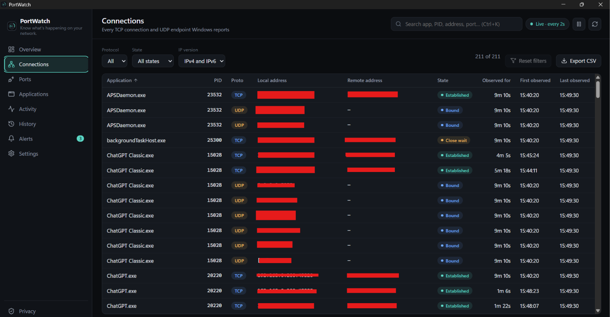
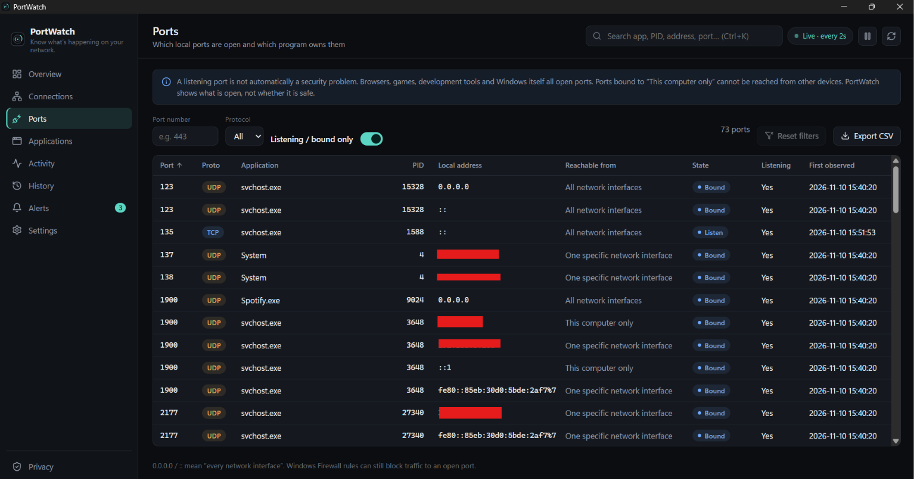
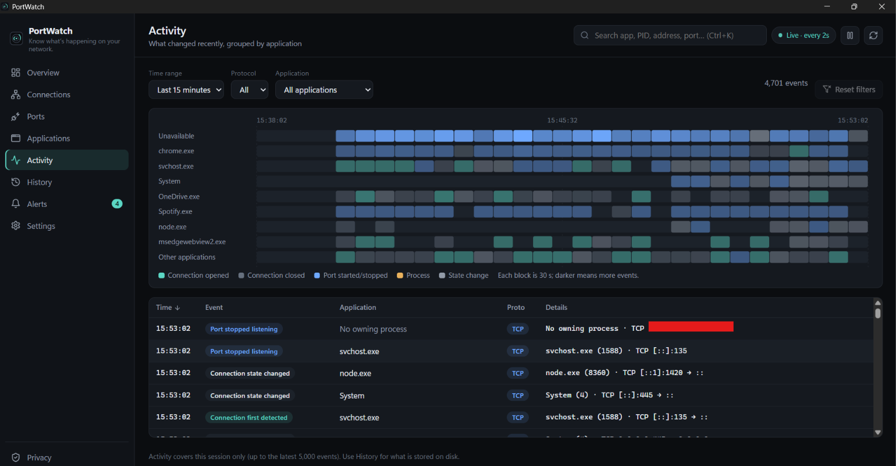
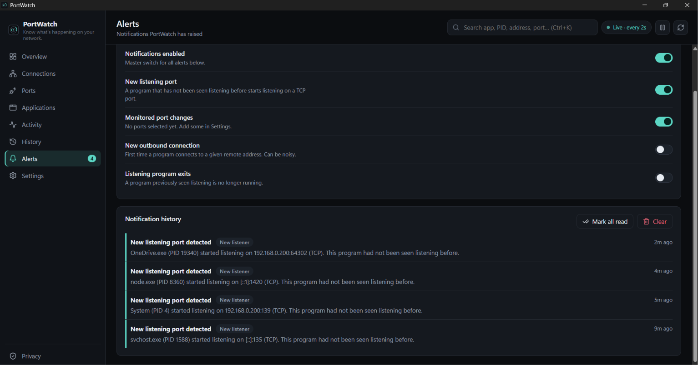

# PortWatch

**Know what's happening on your network.**

PortWatch is a small Windows desktop app that shows which programs are using your network, which ports are open, and how that changes over time. It reads everything from Windows locally and keeps its history on your own computer. It is an independent open-source project by Samarth Chugh ([@Sam3360](https://github.com/Sam3360)).

It is a viewer, not a security product. It is not a firewall, antivirus or malware detector, and it can't block anything.


## Screenshots

Here is a look at PortWatch:

### Overview


### Live Connections


### Listening Ports


### Activity History


### Alerts


## Features

- **Overview** – active connections, TCP sockets, UDP endpoints, listening ports, applications, a live trend and recent changes. Everything comes from real Windows data; when there is none you get an empty state, not sample data.
- **Connections** – every TCP connection and UDP endpoint (IPv4 and IPv6) with process name, PID, addresses, ports, state, first/last observed time and how long PortWatch has watched it. Sort, filter, search, export.
- **Process details** – click any row for the executable path, process start time and endpoint details, plus an "Open containing folder" button. Processes that exit or can't be inspected are handled and explained.
- **Ports** – a port-centred view with port, protocol, owner, bound address ("this computer only" vs "all interfaces"), state and first-seen time. Filters for port number, protocol and listening-only.
- **Applications** – programs observed using the network, with connection counts, listening ports and last activity.
- **Activity** – a per-application timeline of recent changes (this session) you can click into.
- **History** – changes saved to a local SQLite database: connections appearing/disappearing, ports starting/stopping listening, processes starting to use the network, TCP state changes. Search, date range, protocol/application/event filters, CSV export, and a clear button.
- **Alerts** – optional neutral notifications ("New listening port detected"), a notification history, de-duplication and a pop-up rate limit.
- **Settings** – refresh interval, theme, start minimized, launch at startup (opt-in), close-to-tray or exit, notification categories, history retention and data management.
- **System tray** – show, hide, monitoring status, pause/resume, exit.
- **Privacy page** – an in-app explanation of what is and isn't done with your data.
- **CSV export** for current connections, ports, applications and history. You choose where the file is saved.

## Technology

Tauri 2 (Rust backend) · React 18 · TypeScript · Vite · plain CSS · SQLite (`rusqlite`, bundled) · Lucide icons · TanStack Virtual for large tables.

On Windows the backend calls `GetExtendedTcpTable` / `GetExtendedUdpTable` (IP Helper API), the Toolhelp snapshot API for process names, and `OpenProcess` + `QueryFullProcessImageNameW` for paths and start times, through the `windows-sys` crate. There is no command-line parsing of `netstat`.

## Requirements

**To use PortWatch (installer or portable build):** Windows 10 or 11, x64, with the WebView2 runtime (already present on current Windows 10/11; the installer fetches it if not). No Node.js, Rust or Python is needed.

**To build it yourself:**

- Windows 10/11 x64
- [Rust](https://rustup.rs/) (stable, MSVC toolchain) and the **Visual Studio Build Tools** with the "Desktop development with C++" workload (the bundled SQLite needs a C compiler)
- [Node.js](https://nodejs.org/) 18 or newer (development only)
- WebView2 runtime

## Development setup

```powershell
git clone https://github.com/Sam3360/PortWatch.git
cd PortWatch
npm install
npm run tauri:dev
```

`npm run dev` on its own only starts the Vite server. The interface needs the Tauri shell to talk to Windows, and shows a notice in a plain browser tab.

### Checks and tests

```powershell
npm run typecheck      # TypeScript
npm test               # frontend unit tests (Vitest)
npm run test:rust      # builds the frontend, then runs `cargo test`
npm run fmt:rust       # cargo fmt
```

`cargo test` needs the built `dist/` folder because Tauri embeds it, which is why `test:rust` builds the frontend first. The Rust tests use hand-built byte buffers and in-memory databases, so they don't depend on your live connections.

## Building

```powershell
npm install
npm run tauri:build
```

Outputs (under `src-tauri\target\release\`):

- `bundle\nsis\PortWatch_1.0.0_x64-setup.exe` – standard per-user installer (installs and uninstalls cleanly)
- `portwatch.exe` – the bare executable

### Portable build

```powershell
npm run tauri:build
npm run portable
```

This creates `dist-portable\PortWatch-1.0.0-x64-portable.zip`. It contains `portwatch.exe` and a `portwatch.portable` marker file. With the marker present, PortWatch stores its settings and history in a `data` folder next to the exe instead of `%APPDATA%`.

No release binaries are published from this repository's CI; there is deliberately no Windows build workflow. Build locally, or attach binaries to a GitHub release yourself.

## Usage

Start PortWatch and the Overview fills in within a couple of seconds. Some tips:

- `Ctrl+K` (or `/`) focuses search. `Ctrl+1`…`Ctrl+8` switch pages. `Esc` closes the detail panel.
- Search accepts several terms (all must match) and prefixes: `port:443`, `pid:1234`, `proto:udp`, `ip:10.0.0.`, `app:chrome`.
- Closing the window hides PortWatch to the tray by default (change this in Settings). To quit fully, use **Exit PortWatch** from the tray menu.
- The **pause** button stops polling without closing the app.

### What "observed" means

PortWatch can only report what it sees while it is running. "First observed" is when PortWatch first saw a socket, not when the connection really started. Connections that were already open at startup are tracked but not reported as new events, and nothing is known about the time before PortWatch ran.

## Privacy

- All monitoring happens locally. No telemetry, analytics, accounts, update checks or uploads. The app's web view is restricted by a content-security policy so it can't call out to other sites.
- History (time, event type, protocol, addresses, ports, state, process name, PID) is stored in a local SQLite file. Executable paths, command lines and traffic contents are not stored.
- You can turn history off, stop storing remote addresses, set retention, and delete everything from **History** or **Settings → Data**, or by deleting the data folder (`%APPDATA%\io.github.sam3360.portwatch` for the installed version).
- CSV exports are written only where you pick in the Save dialog.

## Limitations

- **Windows only**, x64. The backend uses Windows APIs; on other platforms it reports that monitoring isn't supported.
- **Not a firewall or detector.** It shows state; it doesn't block, filter, score or judge anything.
- **No traffic volume.** Windows' connection tables don't include bytes sent/received, so PortWatch doesn't show bandwidth.
- **No hostnames or geolocation.** Addresses are shown as IPs; PortWatch doesn't do reverse DNS or look anything up online.
- **Polling, not event tracing.** Connections that open and close between two polls can be missed. A shorter interval reduces this; it can't eliminate it.
- **Ownership isn't always known.** Closing connections (TIME_WAIT) are reported by Windows with PID 0. PortWatch shows those as having no owning process rather than guessing.
- **Some processes can't be inspected** without elevation (protected or higher-privilege processes). PortWatch shows "Unavailable" and explains why. Administrator rights are not required for normal use.
- **PIDs are reused** by Windows. Old history rows show the PID and name recorded at the time.
- **UDP has no connections.** UDP is listed as bound endpoints; there is no remote address or state.
- Alerts are based on process *names*, not signatures or hashes.

## Troubleshooting

- **Blank window or "needs its desktop shell"** – you opened the Vite page in a browser. Use `npm run tauri:dev`.
- **`frontendDist ... doesn't exist` when running `cargo`** – run `npm run build` first.
- **Build error about `link.exe` / a C compiler** – install the Visual Studio Build Tools C++ workload.
- **No application name for a connection** – see Limitations; it may be a protected process or a closing connection.
- **History isn't growing** – check that it's enabled in Settings → History and that your retention/maximum aren't very small.
- **Nothing happens when I close the window** – by default it hides to the tray. Use the tray icon, or change "When I close the window" in Settings.
- **Settings file was reset** – if `settings.json` is corrupt PortWatch falls back to defaults and shows a warning banner.

## Contributing

Issues and pull requests are welcome. See [CONTRIBUTING.md](CONTRIBUTING.md). Please report security problems privately as described in [SECURITY.md](SECURITY.md).

## License

MIT. See [LICENSE](LICENSE).
